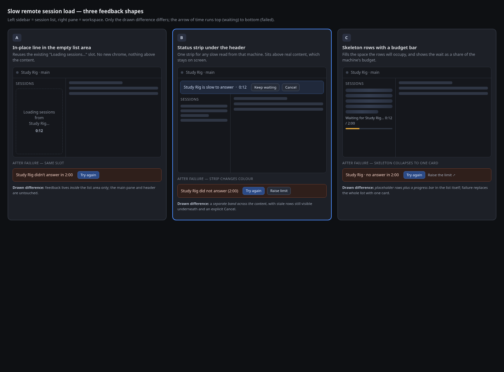

# Remote HTTP Timeout Resilience Design

**Date:** 2026-11-01
**Status:** approved design (revision 2, after review round 1), awaiting implementation plan

## Background

A session list load for a selected remote machine traverses four hops:

```
browser → local gateway (registerMachineProxyRoutes)
        → RemoteMachineClient (server/machines/machineClient.ts)
        → remote gateway (registerSessionProxyRoutes)
        → remote session daemon
```

Five properties of that path explain the reported timeouts.

1. **One fixed ceiling.** `DEFAULT_REMOTE_REQUEST_TIMEOUT_MS = 30_000`
   (`src/server/machines/machineClient.ts:28`) is the fallback budget for every
   federated route that does not name its own. In `src/shared/federatedRoutes.ts`
   only these name one: skills search/install/check/update, package-plugins
   mutation, pi-package install/remove/update, session
   tree-navigate/edit-from-here/fork (5 minutes each), and workspace-task move
   (30 seconds). `GET /sessions` names none, so a session list inherits 30
   seconds.
2. **The ceiling stops at the first byte.** `fetchResponse` clears the timer in
   `finally` the moment `fetch` resolves, i.e. when response headers arrive
   (`machineClient.ts:86-99`). Everything after that — the body — is untimed.
3. **For this route the far side buffers before answering.** The remote
   gateway's session proxy awaits the daemon's complete response body and only
   then replies (`src/server/sessiond/sessionProxyRoutes.ts`, which returns the
   whole `body` string before `reply.send`). So the local budget covers the far
   side's *whole* work for a session list — daemon processing plus payload — and
   the transfer from the far gateway to this browser is what runs after the clock
   stops. Raising patience therefore helps this route; payload size also counts
   against it.
4. **Nothing retries.** The proxy turns one abort into a 504
   (`sendGatewayError` in `machineProxyRoutes.ts`); the session-daemon proxy
   forwards no signal at all (`sessionProxyRoutes.ts`); the browser client throws
   on the first failure (`request()` in `src/client/src/api/http.ts`).
5. **The ceiling is not adjustable.** It is a compile-time constant, and
   `StoredMachine` (`machineStore.ts`) holds no timing field — so a machine on a
   poor link cannot be granted patience that a fast machine is spared.

What the operator sees today: a 504 becomes `HttpRequestError: Remote machine
timeout` in a single red banner (`PiWebUiApp.ts:4945`) — no machine named, no
elapsed time, no way to retry short of re-selecting the workspace.

## Success criteria

1. A session list the far side completes in up to two minutes loads without an
   error.
2. When the budget is exhausted, the user sees which machine, how long it waited,
   and can retry in one click.
3. A slow remote never blocks unrelated work in the tab — local-machine actions,
   other panes, and continuing session loads.
4. Patience is adjustable per machine between 5 seconds and 3 minutes, without
   hand-editing `machines.json`.
5. The local machine behaves exactly as it does today.

## Goals

- Per-machine patience for remote reads, defaulting to two minutes.
- A legible waiting state and an attributable failure state for a slow session
  list, with retry and a jump to the setting.
- A machine edit path, because patience is worthless if it can only be set once.

## Non-goals

See "Out of scope" for the full list. The two that matter most: no automatic
retry-with-backoff, and no stale-list rendering while a slow load runs.

## Decisions

| ID | Decision | Rationale |
| --- | --- | --- |
| D1 | Patience is a per-machine setting, default 120 s, bounds 5 s–180 s. | The bad thing is the link to a particular machine, not the app. A global constant can only be tuned once for all machines. |
| D2 | The wait is accompanied by an in-place status line, and failure names the machine with **Try again** and **Raise limit**. | A longer wait without a signal of life makes the felt problem worse. |
| D3 | The machine budget applies to every federated request to that machine; background refreshes abandon at ~20 s, silently, and retry on their next tick. | A browser keeps six connections per origin. Background refreshes must not hold them for minutes. |
| D4 | Feedback shape A: a line in the session-list section, showing elapsed against the budget. | Reuses the in-place idea already sketched (the existing empty-state wording), keeps the retry target unambiguous, and cannot flash placeholders over a loaded list. |

Review round 1 corrected one point of D4: the wording that told the user "Loading
sessions…" lives in the main pane, which a selected session replaces. The notice
therefore belongs to the **session-list section of the navigation panel**, which
renders whether or not a session is open. That is what the approved composite
depicts.

The chosen UI shape and the two rejected alternatives are recorded in
[`assets/2026-11-01-remote-http-timeout-feedback-shapes.png`](assets/2026-11-01-remote-http-timeout-feedback-shapes.png).

## Design

### 1. Budget resolution

Precedence, most specific first. Only the third row is new.

| Call site | Budget |
| --- | --- |
| The remote health and runtime probes (3 s) | 3 s, unchanged — these measure liveness, not transfer, and must stay short |
| The federated routes that name 5 minutes (skills, package-plugin, pi-package, and session tree operations) | That value, unchanged — their duration is unrelated to link quality |
| Every other federated proxy route | The machine's `requestTimeoutMs`, else 120 000 |
| Browser background refresh to a remote machine | Abandoned at 20 000 by the client |
| Browser foreground read | No client timer; the gateway decides, and the existing selection signal still cancels on supersession |

One override disappears as part of this change. `WORKSPACE_TASKS_MOVE_PROXY_TIMEOUT_MS`
(`federatedRoutes.ts`) names 30 000, which is exactly today's default; an
override that duplicates the default expresses nothing, and while it stays it
would pin that route to 30 seconds on a machine granted two minutes. The route
drops the override and follows the machine budget. The two rows that remain — the
3-second probes and the 5-minute operations — are the ones whose number carries
meaning.

### 2. Machine record and API contract

- `StoredMachine` gains `requestTimeoutMs?: number`. Absent means the default;
  nothing rewrites existing registries.
- Server-side validation in `MachineService.add`/`update`, in the style of
  `validateBaseUrl`: an integer within 5 000–180 000 ms, rejected otherwise with a
  400 and a message naming the field and the range.
- The public `Machine` type carries it, so the browser can display the budget it
  is waiting against.
- The browser parser reads it additively: absent → `undefined`; present must be
  an integer in range, otherwise the response is invalid. A machine record with
  an unknown extra key stays valid.
- `PATCH /api/machines/:machineId` already exists and accepts a partial update;
  the browser client gains `machinesApi.updateMachine`, built through
  `request()` with the machine segment encoded, and typed against the shared
  update type.
- 180 seconds is a product decision: long enough for a genuinely bad link,
  short enough that a dead machine fails while the operator is still watching.
  No server or framework timeout establishes it. (Review round 1 corrected an
  earlier claim here: Fastify's `requestTimeout` defaults to `0`, disabled, and
  Node's 300-second `requestTimeout` governs receiving a request, not waiting for
  an answer.)

### 3. Load provenance

The notice cannot be driven by `state.isLoadingSessions`: the catalog fallback
sets that flag while deliberately avoiding the foreground cancellation scope
(`workspaceController.ts:238-259`), so it does not mean "a human is waiting".

Instead the controller publishes one typed record for the read it is performing:

```
sessionListLoad?: {
  owner: "selection" | "catalog-fallback" | "retry";
  scope: { machineId, projectId, workspaceId, workspacePath };
  startedAt: number;          // from the injected clock
  budgetMs: number;           // the machine's effective budget, captured at start
  phase: "waiting" | "receiving";
}
```

Rules: exactly one record at a time; it is replaced only by a newer read in the
same scope; it is cleared on success, on failure (replaced by the failure record),
and on selection change. The notice renders only for `owner` values a human
initiated (`selection`, `retry`) — a catalog fallback stays silent, as it does
today.

### 4. Background abandonment and disconnect cancellation

The client gives background refreshes a short leash. Two rules the implementation
must state explicitly, because both directions are easy to get wrong:

- A bow-out is never reported as a background error.
- A non-cancellation failure from a background refresh keeps reporting exactly as
  it does today.

**Abort classification.** A deadline must abort with the marker the app already
understands. `isLoadCancellation` (`cancellableLoadScope.ts:59`) accepts
`LoadCancelledError` and `AbortError`; `AbortSignal.timeout()` rejects with a
`TimeoutError` instead, so a naive timeout would surface as a background error.
The background helper aborts its controller with `LoadCancelledError`, and every
reporting site that can observe a bow-out applies the classifier before reporting.
(Review round 1, finding 1.)

**Disconnect cancellation.** A browser abort tears down the socket to *this*
gateway only. Today the proxy passes no disconnect signal to
`RemoteMachineClient`, so an abandoned refresh leaves the gateway's upstream
request — and the far side's work — running to completion. With a five-second
poll and a two-minute budget that is exactly the amplification this design
previously claimed could not happen. (Review round 1, finding 2.)

So federated proxy routes cancel their upstream request when the client
disconnects:

- `MachineRequestOptions` gains an optional `signal`.
- `machineProxyRoutes` derives a signal from the reply's connection close and
  passes it through; `RemoteMachineClient` combines it with its own deadline.
- The session-daemon proxy on the receiving side is a separate gateway; it gains
  the same treatment for its own hop, so cancellation chains where both ends are
  current. Where the far gateway is older, its work continues to its own ceiling —
  documented, not engineered around.

**Sites.** The exact call sites are pinned by the specification after inspecting
each one. Current candidates, all of which pass no signal today:
`workspaceController.ts:151` (invalidation refresh), `:454`, `:584`;
`sessionController.ts:1165`; `projectActivityOwnershipCoordinator.ts:145`;
`PiWebUiApp.ts:3845`; the project catalog poller
(`projectCatalogController.ts`, 5 s); the git status refresh (8 s); the memory and
learned-skills snapshots (30 s). The spec classifies each as background or
foreground rather than applying a blanket rule, because
`workspaceController.refreshProjectSessions` and the `selectWorkspace` reads are
foreground and already carry a signal.

`AbortSignal.timeout` and `AbortSignal.any` need small fallbacks for browsers that
lack them; `cancellableLoadScope`'s classifier remains the single place that
decides what counts as cancellation.

### 5. Waiting and failure states

Applies only when the selected machine is remote, and only to a load whose owner
is `selection` or `retry`.

| Phase | Elapsed | Session-list section |
| --- | --- | --- |
| waiting | under 5 s | unchanged — no notice |
| waiting | 5 s or more | "Loading sessions from *<machine>*… 0:12 of 2:00" |
| receiving | any | "Receiving sessions from *<machine>*…" — no budget, because the budget governs the wait for the first byte and the transfer is deliberately unbounded |
| failed | budget exhausted | "*<machine>* didn't answer within 2:00" with **Try again** and **Raise limit** |
| failed | transfer broke mid-body | "*<machine>* stopped responding while sending sessions" with the same two actions |
| done | — | the rows |

The clock ticks once a second only while a load is in flight, shows elapsed from
`startedAt`, and shows the budget captured in the load record. The transition from
`waiting` to `receiving` comes from the transport reporting that the response has
begun, which the API layer reports through a small optional callback rather than
by inspecting the response twice. (Review round 1, finding 3: without this the
notice would promise a two-minute deadline that stops applying the moment the far
side answers.)

### 6. Failure attribution and retry

The session-list read records a typed failure rather than matching on error text:

```
sessionListFailure?: {
  scope: { machineId, machineName, projectId, workspaceId };
  kind: "timeout" | "transfer";
  elapsedMs: number;
  budgetMs: number;
}
```

**No banner suppression.** The failure above owns its own display in the
session-list section; `state.error` is not written by this read at all. That is
simpler than suppression and removes the case where an unrelated later error is
hidden behind a stale typed failure. Existing rules that key off `state.error`
keep their present meaning, and `shouldShowSessionStartScreen` additionally
requires that no typed session-list failure is present, so a failed load does not
present a start screen that claims the workspace is empty. (Review round 1,
findings 4 and 5.)

**Try again** calls a dedicated `retrySessionList()` that re-reads only the
session list for the current *(machine, project, workspace)* scope under the same
supersession guards as the original load, keeps the selected session, publishes a
fresh load record, and clears the failure record.

**Raise limit** opens the machine dialog prefilled for that machine with the
patience field focused.

### 7. Machine edit path

The dialog is create-only today and no browser code calls the update route, so
this part is genuinely new surface:

- `MachineDialog` gains an edit mode: prefilled fields, a patience field (number,
  in seconds, bounded), and a submit payload that includes `requestTimeoutMs`.
- Both machine menus route **Edit** through the same app-owned callback: the
  compact list's "⋯" action menu (`MachineList.ts`) *and* the desktop switcher's
  own actions menu (`MachineSwitcher.ts`, which today offers only Remove).
  (Review round 1, finding 7.)
- `machinesApi.updateMachine(id, patch)` → `PATCH /api/machines/:machineId`.
- A failed update shows the server's validation message in the dialog; the dialog
  stays open with the entered values.

### 8. Invariants to preserve

- The remote timer is cleared when response headers arrive, never after the body.
  Extending it to body streaming would guillotine large responses; this design
  keeps the current placement and states it as an invariant.
- The remote health and runtime probes keep their 3-second budget.
- Browser paths stay application-relative and are resolved once at the browser
  boundary, per the project's URL convention.
- The local machine has no budget, no notice, and no behaviour change.

## Error handling

| Situation | Today | After |
| --- | --- | --- |
| Remote answers within budget | rows appear | unchanged |
| Remote slower than the machine budget | 504, generic banner | timeout failure in the session-list section, naming machine and elapsed, with retry |
| Far side starts answering, transfer stalls | hangs until the socket errors | "receiving" notice; on failure, a transfer failure with elapsed time, not a timeout |
| Background refresh exceeds 20 s | held to the 30 s ceiling, then a background error | aborted with the cancellation marker, silent, upstream request cancelled, retried next tick |
| Machine unreachable (DNS, refused) | 502 banner | unchanged — this is not a timeout |
| Machine deleted mid-flight | 404 | unchanged |
| Invalid patience value saved | n/a | 400 with the field and range named; nothing persisted |
| Local machine load fails | banner | unchanged |

## Edge cases and risks

1. **Six connections per origin.** Long-held foreground reads compete with other
   traffic to the same origin. The 20 s bow-out, combined with disconnect
   cancellation, bounds how much background work a slow machine can accumulate.
2. **A reverse proxy in front may cut earlier.** Many deployments default to a
   60 s read timeout. Raising the machine budget above the deployment's proxy
   timeout has no effect, and the documentation must say so.
3. **Nested federation.** If the selected machine is itself a gateway that
   federates to a third (A → B → C), an older B still applies its own 30-second
   ceiling to its outward hop, and patience on A cannot extend B's. This does not
   apply to the ordinary two-hop case: a remote gateway places no timeout on its
   own daemon call. (Review round 1, finding 8, corrected an earlier
   misattribution here.)
4. **Far-side cancellation depends on the far side's version.** Our gateway stops
   its own work immediately on disconnect; whether the remote stops its daemon
   call depends on that gateway honouring disconnects.
5. **A dead machine now takes longer to fail.** Two minutes instead of 30
   seconds. This is the accepted cost of the chosen approach, mitigated by the
   visible clock; **Raise limit** is the remedy for a machine that is habitually
   slow rather than dead.
6. **Poll cadence degrades before it piles up.** The catalog poller is
   single-flight (`inFlight` plus a queue), so a slow machine reduces refresh
   cadence rather than accumulating requests — and with disconnect cancellation, an
   abandoned refresh releases its upstream work too.
7. **Retry storms.** **Try again** is a user action, not a timer; no automatic
   retry exists, so repeated slow loads cannot self-amplify.

## Test strategy

By layer, narrowest first:

1. **Machine client:** an explicit per-call budget wins; absent a per-call budget
   the machine's value applies; absent both the 120 s default applies; the timer
   still stops at headers; an incoming `signal` cancels the request.
2. **Machine service:** bounds accepted at 5 000 and 180 000, rejected below,
   above, non-integer, and non-numeric; the value survives a store round trip and
   its absence does not.
3. **Machine store:** a registry without the field parses, and an update that
   omits the field leaves it absent rather than writing a default.
4. **Proxy contract:** the budget reaching `RemoteMachineClient` comes from the
   machine record; a 5-minute route is unaffected; the workspace-task move route
   follows the machine budget rather than a redundant 30 s override; a client
   disconnect cancels the upstream request.
5. **Browser parser and client:** additive parse with the field absent, present,
   and malformed; `updateMachine` sends `PATCH` with the encoded machine segment
   and the exact outbound body; a nested base path stays correct.
6. **Load provenance:** a catalog fallback publishes no notice-visible load; a
   selection and a retry do; the record carries the captured budget and clock.
7. **Session-list notice:** appears only after 5 s, only for a remote machine,
   only for a human-initiated load; shows elapsed against the machine budget;
   switches to "receiving" when the response begins; stops on completion,
   failure, and selection change.
8. **Failure display:** the timeout failure renders in the session-list section
   with both actions; `state.error` is untouched; the start screen stays hidden
   while a typed failure is present; a subsequent unrelated error displays
   normally.
9. **Retry:** re-reads only the session list, keeps the selected session, respects
   supersession, and shows its own failure when a session is open.
10. **Background bow-out:** a deadline abort is classified as cancellation and
    reports nothing, with separate tests for a native timeout signal, the
    fallback, supersession, and a genuine failure.
11. **Transfer phase:** a delayed body keeps the notice in "receiving" and a
    mid-body failure produces the transfer failure rather than a timeout.

Fake timers, injected clocks and injected fetch throughout; no test touches a
real network. Final validation is `npm run verify`.

## Documentation plan

- The machine federation page gains a short section on slow-link patience: the
  default, how to raise it per machine, and the two limits — a reverse proxy in
  front of this gateway, and nested federation through an older gateway.
- The configuration reference already documents the machine registry file; if it
  lists machine fields, the new field joins that table. Placement follows the
  repository documentation guide, which keeps detail under `docs/` and the README
  short.
- A Changeset entry, because a user-visible behaviour and a new setting change.

## Out of scope

Automatic retry with backoff; showing the last known list while a slow load runs;
paging or streaming the session list; per-route patience lists; any change to the
health or runtime probes; any change for the local machine; request coalescing or
circuit breakers; compressing or reshaping the session-list payload.

## UI record

Three shapes were drawn and compared as one composite; shape A was chosen.

| Option | Shape | Outcome |
| --- | --- | --- |
| A | In-place line in the session-list section, elapsed against budget, Try again plus Raise limit | **chosen** |
| B | Status strip under the header spanning the content, with Keep waiting and Cancel | rejected — needs machine-wide in-flight state the app does not have, and the retry target becomes ambiguous |
| C | Skeleton placeholder rows plus a budget progress bar | rejected — needs a placeholder branch in the list and can flash over a loaded list; its two useful ideas (elapsed-of-budget, Raise limit) were folded into A |


