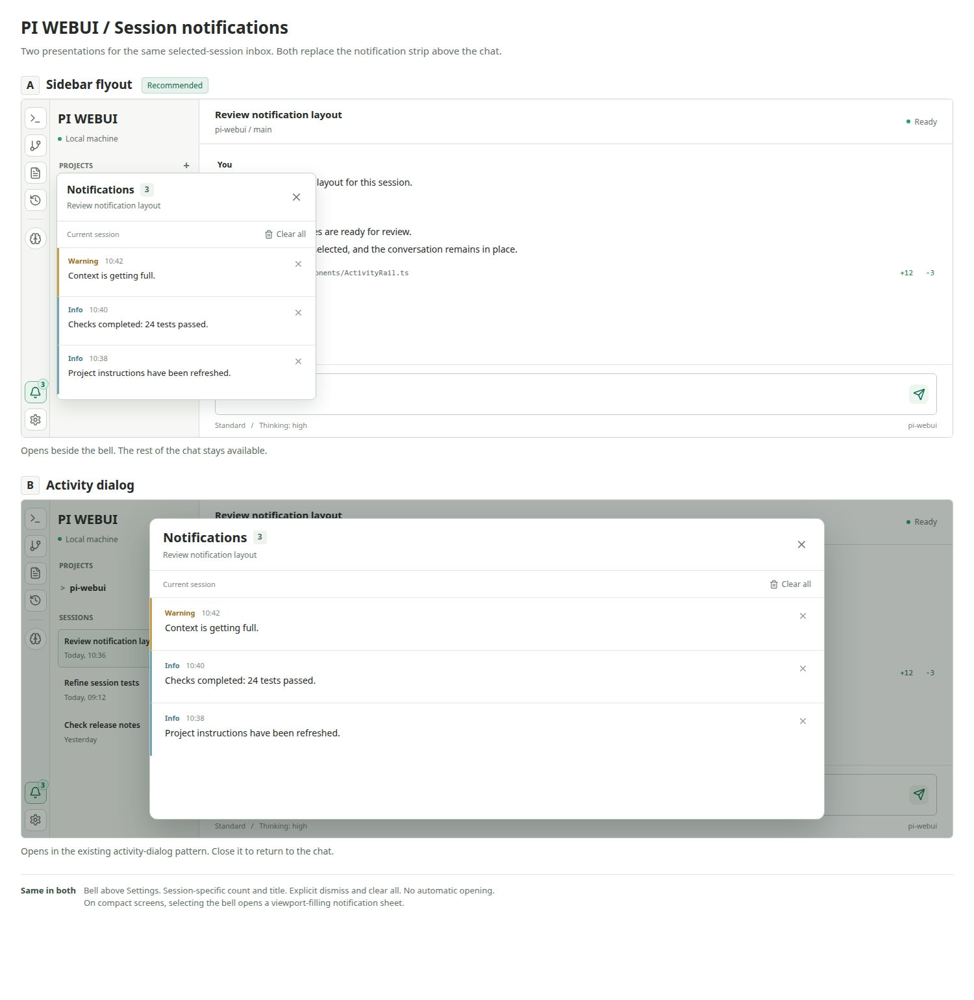

# Selected-Session Notifications in the Activity Rail

**Status:** In independent design review. The user selected layout A and approved the interaction, reliability, and written draft; execution authorization remains pending.

## Goal

Move the current session's notification inbox from the strip above the chat to a predictable home in the Activity Rail. A bell above Settings opens a compact, non-modal tray so a user can inspect or dismiss notifications without losing the conversation. The inbox, bell count, and session title always refer to the selected session.

This is a relocation of the existing session inbox, not a global notification center or a new permanent history. Keep the session daemon as the owner of notification data and preserve the existing session and machine boundaries.

## Chosen Presentation

The user chose **A: Sidebar flyout** in the comparison below. B, the larger modal dialog, is not the chosen design.

On desktop, place the bell directly above the fixed Settings control, independent of the reorderable core buttons and plugin activities. Clicking it opens a readable, scrollable flyout beside the rail. The flyout may cover part of the navigation panel, as shown in A; it does not resize the application, dim the background, trap focus, or block the rest of the chat.

On compact layouts, the bell remains in the compact Activity Rail. Selecting it closes the compact rail and opens the same inbox as a viewport-filling **modal** sheet. The sheet contains the same title, state, notifications, and actions as the desktop flyout. Focus starts at its heading, Tab and Shift+Tab stay inside it, and the covered application cannot receive pointer, keyboard, or global shortcut actions. Escape is handled by the sheet before background actions such as prompt-speech cancellation. Merely adding `aria-modal` to a section does not satisfy this behavior. The compact rail launcher reflects the selected session's count while the rail is closed, so notifications remain discoverable without opening the rail. Existing rail ordering and plugin preferences are not changed.

An open tray remains open when crossing the existing desktop/compact rail breakpoint. Transfer it to the new presentation with exactly one notification list, unchanged inbox identity, and no dismissal or announcement replay. On entering compact layout, focus the equivalent connected control inside the modal sheet, falling back to its heading. On returning to desktop, restore the equivalent tray control if focus was inside the sheet. Closing later returns focus to the visible launcher for the current layout, never to the hidden desktop bell or a removed compact control. Opening another application modal closes the desktop flyout without returning focus over that modal.

## Inbox and Badge

- Display the selected session's name, using the existing session-title fallback when it has no name, and the full notification count in the tray.
- The badge represents the existing total of undismissed retained notifications plus the count of older notifications no longer shown. It is not an independent unread count. Hide a zero badge; display counts above 99 as `99+`, while exposing the full count in the accessible label and tray.
- Each visible notification retains its severity, time, message, truncation notice when applicable, and individually labelled dismiss control. Retain the existing indication when older notifications have been discarded by the bounded inbox.
- Provide a Clear all action scoped to the selected session. Opening, closing, or viewing the tray never dismisses notifications.
- The bell stays visible but disabled when there is no active selected session, including a pending or archived session. A current empty inbox shows an explicit empty state.
- A selected session's loading, unavailable, and empty states are distinct. Do not show a previous session's rows or badge as the current session's data. A stale or unavailable count is not presented as zero or as a current count.

## Presentation States

Derive presentation from the current machine, session identity, capability negotiation, reachability, and complete inbox status, not solely from `selectedNotificationView()`. That fresh-only helper intentionally returns no value for several different states. Capability decisions follow the existing negotiated/accepted-support rules; absence of an inbox is not proof of lack of support. Apply the following precedence, rejecting mismatched machine/cwd/session data before rendering:

| Condition | Tray and Bell Behavior | Recovery |
| --- | --- | --- |
| No active selected session, or pending/archived selection | Disabled bell, no count, and close any open tray with a connected focus fallback | Selecting an eligible session re-enables the bell |
| Selected machine is explicitly unreachable, including on initial selection | Enabled bell opens an offline/unavailable state; no numeric badge or notification rows; dismiss disabled | Retry rechecks through the existing machine/runtime recovery flow; no inbox request while still unreachable |
| Notification support is not yet known, or runtime negotiation failed | Enabled bell opens a capability-unavailable state, distinct from an empty inbox; no count or dismiss actions | Use the existing capability refresh flow on retry; show checking/loading only while a real request is pending, then show the observed outcome |
| Runtime is known not to support notification inboxes | Enabled bell opens an unsupported-runtime explanation; no count or dismiss actions | Do not offer an ineffective inbox retry or call an unsupported endpoint; preserve legacy command output |
| Supported and reachable, with a current identity-matched fresh inbox | Show current rows, full count, and dismissal actions, or the explicit empty state | Background refresh does not discard this still-current view |
| Supported and reachable, no fresh matching inbox, and an actual current refresh is pending | Show loading, without old rows or a numeric badge; dismiss disabled | The current request's outcome selects fresh or unavailable |
| Supported and reachable, with stale/missing data but no current request, or a failed refresh | Show unavailable, not empty or indefinitely loading; no current count or dismiss actions | Retry starts the current session's inbox refresh and reconnect schedules the same recovery |

Late results cannot change a newer selection's state or clear its loading/error state. Retrying while offline never reports success or a current empty inbox. Retrying while support is unknown must resolve capability first; it cannot invoke the inbox endpoint optimistically.

## Interaction and Focus

- The desktop bell toggles the flyout. Escape, its close control, or a click outside the flyout closes it. The user can continue interacting with the chat; new notifications never open the flyout or move focus.
- A keyboard opening places focus in the tray. A close using Escape, the close control, or the bell restores focus to the bell when it is available. An outside click closes the tray without stealing focus from the clicked target.
- Clicking another session outside the flyout closes it as an outside click. If selection changes while the tray remains open, such as through a keyboard or route change, keep the surface open and immediately replace the old session's rows and count with the new session's loading or appropriate unavailable state. Never publish a late result for the previous machine, workspace, or session into the current tray.
- For any dismissal that removes the focused row or its control, retain the existing next-row, previous-row, then-heading focus order, including optimistic removal while other rows remain. Clear all moves focus to the tray heading. Keep the empty tray open after dismissing its last row.
- Deferred focus recovery is valid only for the same machine/cwd/session, open-tray generation, and focus intent. Cancel it on closure, selection change, or a later pointer/keyboard focus movement; an async success or rollback must not steal focus back from the composer or another surface. When a selection or availability change removes focused controls, move focus to the still-open tray heading, or to a connected launcher/application fallback if the tray closes.
- The compact sheet closes through its close control or Escape and restores focus to the compact Activity Rail launcher when available. Its content fits and scrolls within the viewport, including narrow screens and mobile safe areas.

## Failure, Concurrency, and Lifetime

The existing selected-session notification controller owns inbox snapshots, events, optimistic dismissals, and selection generation checks. The UI consumes that one projection for the list and badge; it does not introduce a second independent notification store.

- While the selected inbox loads, show a loading state. When loading fails or the selected machine disconnects, show an unavailable state and a retry action rather than an empty inbox. Disable dismissal until a current inbox is available. Reconnection and an explicit retry refresh the currently selected session; a retry while the machine remains offline continues to report that it is unavailable.
- If an individual dismissal or Clear all fails, restore the affected visible notifications and report the failure. Existing per-notification pending state prevents duplicate actions. Clear all uses the captured session and dismissal watermark, so notifications arriving after the action began remain visible.
- Switching sessions never itself dismisses notifications. Notifications are held for the active session runtime and are not permanent history. Stopping or archiving a session, replacing its runtime, or restarting the session daemon may clear them under existing lifecycle rules. This feature does not change those rules or add persistence.
- Preserve compatibility with older or incapable remote runtimes. They must not be presented as a freshly loaded empty inbox; retain the existing legacy command-output behavior without duplicating notifications on capable runtimes.

## Existing Surfaces and Accessibility

Remove the selected-session notification list from the top-of-chat notices, including its old collapse control. Keep unrelated session warnings, speech errors, and action-blocking errors in their existing context surfaces. There is exactly one visible session-notification list at a time.

The bell has a meaningful accessible name that includes the selected-session notification count when current, reports whether the tray is open, and references the tray. The non-modal desktop tray has a labelled region; the compact sheet provides the modal and focus behavior specified above. Notification dismiss and clear controls have accessible labels.

One application-owned announcer remains mounted independently of the tray, sheet, chat transcript, and fresh-only inbox selector. Keep the existing severity-only polite/assertive labels. New accepted live-event notifications for the selected identity enter it once, including while the tray is closed. Track delivered IDs by machine/cwd/session and daemon identity, independently of fresh/stale view transitions; stable announcement nodes must not be removed and reinserted merely because the inbox becomes stale or its presentation changes. Snapshots are inbox reconciliation, not new-event announcements. Opening, closing, switching layout, retrying, reconnecting to the same daemon, or selecting a session with existing notifications never re-announces its snapshot. A daemon change starts a new delivery identity and must not replay the old daemon's announcements. Use bounded recent announcement nodes and a monotonic live-notification delivery cursor per active selected identity; reset on selection/daemon replacement, without creating a persisted notification history. The existing ordered live-event join guards still reject duplicate/stale events. Do not mount competing live regions in the chat and tray.

Use the application's existing theme tokens, icon-button styling, selected-session identity, and responsive Activity Rail conventions. The mockup establishes structure and behavior, not fixed color values.

## Ownership and Scope

`PiWebUiApp` owns the open/closed state and the association between the selected session and the notification presentation. `ActivityRail` remains a presentation component that receives the bell state and callbacks. A focused notification-tray view renders the existing inbox projection and dispatches the existing dismiss and retry operations; it does not own transport or persistence. Keep session and machine identity checks in the existing controller boundary.

Do not introduce a plugin dependency for this core control, a global cross-session inbox, notification read/unread synchronization, new storage, or a session-daemon protocol change. Keep legacy command output and unrelated top-of-chat notices intact. User-facing documentation belongs on an appropriate detailed page under `docs/`, with a Changeset for the user-visible feature; the README remains a concise entry point.

## Verification

Use the repository testing guide and test observable behavior at the smallest meaningful layer.

- Controller and state tests cover the full presentation-state precedence, especially selecting an already-offline remote, unknown versus confirmed-unsupported capability, no-request loading fallbacks, late completions, dismiss failure recovery, Clear all racing a new notification, overflow, and unavailable/retry states.
- Component tests exercise the bell, count, tray and empty states, individual dismiss and Clear all, accessible names, closing, and removal of the old notification strip without removing other notices. Focus tests cover next/previous/header recovery for any row, Clear all, and cancellation of deferred recovery after a session change, closure, or user focus movement.
- Announcement tests pin one append per accepted live ID while closed, including stale-to-fresh same-daemon recovery and duplicate-event replay. Opening/closing, desktop/compact handoff, selection snapshots, and daemon replacement must not replay prior announcements.
- Real browser checks cover desktop placement and outside-click focus behavior, compact initial focus and focus containment, suppression of covered-app shortcuts and pointer actions, both directions of breakpoint handoff, and restoration to a visible launcher. Check long-notification scrolling and absence of overlap or clipped controls at desktop and mobile sizes.
- Preserve rolling compatibility with older runtimes and confirm that selecting another session does not mutate the previous session's inbox.
- Before final audit, run the full project suite and typecheck as required by the project workflow. No production tests or implementation have run during this design stage.
